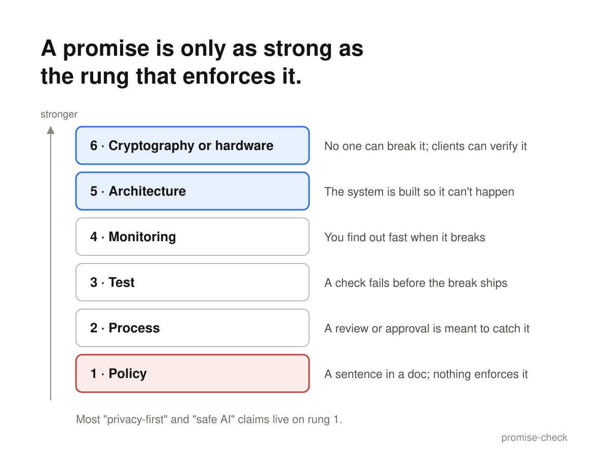

# promise-check

Find every promise your system makes, and see what actually keeps it.

I spent years shipping messaging and privacy features. Building the feature was rarely the hard part. The hard part was every place the promise didn't reach yet: the backup, the second device, the log line someone added two quarters later. I wanted a tool that asks "what stops this from happening?" for every sentence that sounds like a guarantee. This is that tool.

## The enforcement ladder

promise-check places each promise on one of six rungs. The higher the rung, the less the promise depends on people remembering a rule.



| Rung | Name | What keeps the promise |
|---|---|---|
| 6 | Cryptography or hardware | Math or silicon. Even the operator can't break it, and clients can check |
| 5 | Architecture | The system has no path to break it |
| 4 | Monitoring | Someone finds out fast when it breaks |
| 3 | Test | A check fails before the break ships |
| 2 | Process | A review or approval is supposed to catch it |
| 1 | Policy | A sentence in a doc, a contract or a prompt |

Most "private by design" and "safe AI" claims I've read live on rung 1. Usually nobody is lying. Writing the sentence is cheap, and moving it up the ladder is real engineering work.

## What an audit looks like

Run on a design doc for an AI support agent:

```
5 promises: 2 enforced, 2 partial, 1 policy-only.

| # | Promise                                    | Rung | What enforces it                                     | Verdict     | Next rung                                   |
|---|--------------------------------------------|------|------------------------------------------------------|-------------|---------------------------------------------|
| 1 | Never refunds over $100 without a human    | 5    | Payments service rejects it without a signed token   | Enforced    | —                                           |
| 2 | Never shows another customer's data        | 5    | Lookup tool takes no customer ID; bound to session   | Enforced    | —                                           |
| 3 | Always hands off when asked                | 2    | System prompt + weekly sample of 50 transcripts      | Partial     | A classifier that forces escalate()         |
| 4 | Answers are grounded in help articles      | 3    | CI eval blocks changes below 92% cited answers       | Partial     | Live grounding monitor on production traffic |
| 5 | Provider doesn't retain conversations      | 1    | Zero-retention agreement                             | Policy-only | Route through a gateway that strips identifiers |
```

The same doc says "never" for promises #1 and #3. One is four rungs stronger than the other.

You also get the three riskiest promises and the questions to ask when the material doesn't say.

## Two ways to use it

**Audit once, with the skill.** `skills/promise-check` is an agent skill: a folder with a `SKILL.md`. In Claude Code, copy it to `~/.claude/skills/` (all projects) or `.claude/skills/` (one repo), then ask:

> Run promise-check on docs/design.md

It works on design docs, RFCs, PR descriptions, privacy whitepapers, READMEs and agent system prompts. Other agents that load skills can point at the same `SKILL.md`.

**Keep it honest on every PR, with promise-lint.** Promises drift. Someone refactors away the refund check, and the README still says "never." [`promise-lint`](lint/README.md) ties each promise in your docs and prompts to the file that enforces it, and fails the build when that file disappears or loses the check. It's plain Python with no API key.

```yaml
- uses: shalinisah-dev/promise-check@v0
```

## How well it works

I keep a set of eval cases: two synthetic systems with traps planted in them, plus Apple Private Cloud Compute and Signal's sealed sender, checked against their public write-ups.

In a blind run, where the auditing session never saw the answer keys, it found 18 of 18 promises. It got the verdict right on 15 and the rung right on 16. The misses, and what I'm changing because of them, are in [evals/BLIND-RESULTS.md](evals/BLIND-RESULTS.md). To run the evals yourself, see [evals/README.md](evals/README.md).

## What's next

promise-check answers "what does this system promise, and what enforces it?" The next question is whether the promise held. That's **replay**, which re-checks an agent's claimed wins against an evaluation the agent can't edit. It starts with autonomous research loops, where an agent can report a better number without building a better model.

Issues and pull requests are welcome. The most useful contributions are real, public documents where you think the tool gets a rung wrong.

## License

[Apache 2.0](LICENSE)
